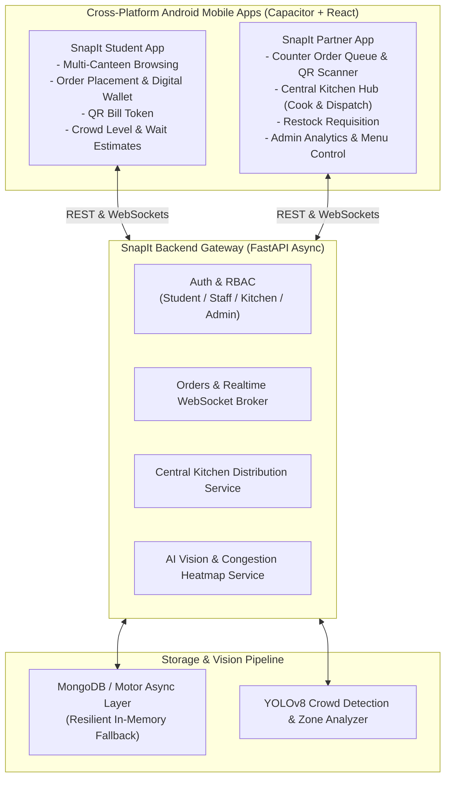

# ⚡ SnapIt — Smart Campus Food Ordering & Kitchen Distribution System

[](https://fastapi.tiangolo.com)
[](https://react.dev)
[](https://vitejs.dev)
[](https://capacitorjs.com)
[](https://www.mongodb.com)
[](https://github.com/ultralytics/ultralytics)
[](https://www.android.com)

**SnapIt** is a smart campus dining and kitchen logistics ecosystem designed for institutional campuses with multiple distributed canteens. It solves long mealtime queues, food prep bottlenecks, decentralized stock shortages, and cafeteria overcrowding through real-time mobile ordering, QR ticket verification, automated central kitchen replenishment, and computer-vision crowd density analysis.

---

## 📱 Mobile Applications & Pre-built APKs

SnapIt provides two dedicated native Android applications built using Capacitor and modern React:

| Application | Description | Pre-built Android Package |
|:---|:---|:---|
| **SnapIt (Student / Customer)** | Campus food ordering, multi-canteen browsing, live cart & checkout, digital token bills with QR code viewer, order status tracking, and live canteen crowd heatmaps. | [`apks/SnapIt-Student.apk`](apks/SnapIt-Student.apk) |
| **SnapIt Partner (Staff & Kitchen)** | Comprehensive operations tool featuring Counter order fulfillment, QR ticket scanner, Central Kitchen batch cooking pipeline, automated restock alerts, and Executive Admin analytics. | [`apks/SnapIt-Partner.apk`](apks/SnapIt-Partner.apk) |

> 💡 **Quick Install**: Download the `.apk` files directly to any Android 8.0+ device from the [`apks/`](apks/) folder and enable *Install from Unknown Sources* to run immediately.

---

## 🏛️ System Architecture



---

## 🌟 Key Features

### 1. 🎓 Student Experience (`snapit/`)
* **Multi-Canteen Selection**: Browse across 11 institutional campus dining zones (Central Block, Food Court, Library Complex, Engineering Quad, Science Tower, Hostels, etc.).
* **Instant Digital Checkout**: Student wallet balance or online payment gateway with instant QR token bill generation.
* **Live Order Progression**: Real-time status sync via WebSocket: `PLACED` ➔ `PREPARING` ➔ `READY` ➔ `COMPLETED`.
* **Digital Bills & History**: Access past invoices, view dynamic QR codes for pickup verification, and download PDF receipts.
* **Crowd Congestion & Wait Insights**: Visual indicators for low, moderate, and high crowd levels to pick the best lunch venue.

### 2. 🏪 Partner Counter & Staff Portal (`snapit-partner/`)
* **Live Order Stream**: Instant incoming orders with countdown timers and sound alerts.
* **Camera-based QR Scanner**: Scan customer bills directly with device camera to instantly verify tokens and prevent duplicate pickups.
* **One-Click Restock Requisition**: Alert the central kitchen whenever a food item is running low at the counter.

### 3. 🍳 Central Factory Kitchen Distribution Hub
* **Demand Aggregation**: Batch summary aggregating required food quantities across all 11 campus canteens into a consolidated cooking list.
* **Chef Cooking Workflow**: Real-time lifecycle: `REQUESTED` ➔ `COOKING` ➔ `COOKED` ➔ `DISPATCHED` ➔ `RESTOCKED`.
* **Auto-Replenishment Triggers**: Automatic restock generation whenever counter sales deplete an item below its low-stock threshold.
* **Push Delivery Notifications**: Live alerts sent to counter staff when fresh batches are cooked and in transit.

### 4. 📊 Executive Admin Dashboard
* **Real-Time Revenue & Metrics**: Live telemetry on campus gross sales, active queue counts, and average fulfillment duration.
* **Bottleneck Detection**: Predictive flags identifying queues exceeding operational thresholds.
* **Live Menu Control**: Instantly update pricing, toggle availability, and adjust restock trigger levels.

### 5. 👁️ AI Crowd Analysis Engine (`crowd_service.py` & YOLOv8)
* Computer vision analysis on dining hall video feeds.
* Bounding-box detection, Euclidean distance clustering, and zone mapping for accurate congestion indexing.

---

## 📂 Repository Structure

```text
snapit/
├── apks/                                 # Ready-to-install Android APK binaries
│   ├── SnapIt-Student.apk                # Customer ordering app build
│   └── SnapIt-Partner.apk                # Staff & Kitchen partner app build
├── backend/                              # FastAPI async backend server
│   ├── routes/                           # API endpoints & WebSocket handlers
│   │   ├── auth.py                       # User registration, login, wallet balances
│   │   ├── menu.py                       # Canteen & menu management
│   │   ├── orders.py                     # Order lifecycle & WebSocket manager
│   │   ├── kitchen_distributor.py        # Central kitchen pipeline & batch aggregation
│   │   ├── analytics.py                  # Admin telemetry & bottleneck detection
│   │   └── payments.py                   # Wallet & online payment transactions
│   ├── services/                         # Background services
│   │   └── crowd_service.py              # Real-time crowd update worker
│   ├── app.py                            # FastAPI application entry point
│   ├── database.py                       # MongoDB connection & campus seeding
│   ├── models.py                         # Pydantic data schemas
│   ├── requirements.txt                  # Python dependencies
│   └── test_kitchen_distributor.py       # Central kitchen integration tests
├── snapit/                               # Student / Customer mobile application
│   ├── android/                          # Native Android studio project (Capacitor)
│   ├── src/
│   │   ├── pages/                        # StudentDashboard, MenuPage, OrderStatus, BillsPage, LoginPage
│   │   ├── components/                   # CartDrawer, CanteenCard, QRDisplay, ZoneHeatmap
│   │   └── api.js                        # HTTP & WebSocket API client
│   ├── capacitor.config.json             # Native capacitor configuration
│   └── package.json                      # Node.js dependencies & scripts
├── snapit-partner/                       # Partner / Staff / Kitchen mobile application
│   ├── android/                          # Native Android studio project (Capacitor)
│   ├── src/
│   │   ├── pages/                        # CounterPage, KitchenPage, AdminDashboard, PartnerLoginPage
│   │   ├── components/                   # QRScannerTab, MetricCard, BottleneckAlert
│   │   └── api.js                        # HTTP & WebSocket API client
│   ├── capacitor.config.json             # Native capacitor configuration
│   └── package.json                      # Node.js dependencies & scripts
├── dataset_video*.mp4                    # Canteen crowd sample video feeds
├── crowd_analyzer.py                     # YOLOv8 crowd tracking & spatial clustering script
├── zone_mapping.py                       # Counter & seating zone mapping utility
└── README.md                             # Project documentation
```

---

## 🚀 Quick Start & Installation

### 1️⃣ Prerequisites
* **Python**: 3.10+
* **Node.js**: 18+ and `npm`
* **MongoDB**: Local MongoDB or free MongoDB Atlas cluster (optional, defaults to resilient in-memory mode if unavailable)
* **Android Studio**: (Only required if rebuilding native Android APKs)

---

### 2️⃣ Backend Setup

```bash
# Navigate to backend directory
cd backend

# Create and activate a virtual environment
python -m venv venv
# On Windows:
.\venv\Scripts\activate
# On Linux/macOS:
source venv/bin/activate

# Install required packages
pip install -r requirements.txt

# (Optional) Set your MongoDB connection URI
# Default: mongodb://localhost:27017
# set MONGODB_URI=mongodb+srv://<user>:<password>@cluster.mongodb.net/snapit

# Start the FastAPI development server
uvicorn app:app --reload --host 0.0.0.0 --port 8000
```

Verify backend health at `http://localhost:8000/api/health` or browse interactive Swagger docs at `http://localhost:8000/docs`.

---

### 3️⃣ Running the Student Mobile App (`snapit`)

```bash
# From repository root
cd snapit

# Install dependencies
npm install

# Start Vite development web server
npm run dev
```

To sync changes to Android and run on a physical device/emulator:
```bash
# Build web assets and sync to native Android project
npm run build
npx cap sync android

# Open project in Android Studio
npx cap open android
```

---

### 4️⃣ Running the Partner App (`snapit-partner`)

```bash
# From repository root
cd snapit-partner

# Install dependencies
npm install

# Start Vite development web server
npm run dev
```

To sync changes to Android:
```bash
npm run build
npx cap sync android
npx cap open android
```

---

## 👥 Default Demo Credentials & Roles

| Role | Username | Password | Assigned Scope / Access |
|:---|:---|:---|:---|
| **Student** | `student` | `student123` | Canteen ordering, wallet payments, bill history |
| **Counter Staff** | `staff` | `staff123` | Canteen A counter operations, order queue, QR verification |
| **Kitchen Chef** | `chef` | `chef123` | Central kitchen distribution pipeline & cooking control |
| **Admin** | `admin` | `admin123` | Multi-canteen telemetry, analytics, and menu master |

---

## 🧪 Testing

Run automated tests for the Central Kitchen distribution pipeline and auto-replenishment triggers:

```bash
cd backend
python test_kitchen_distributor.py
```

Expected output:
```text
=== STARTING KITCHEN FACTORY DISTRIBUTOR TESTS ===
[PASS] Initialized menu item Samosa with inventory: 12 (threshold: 10)
[PASS] Created Restock Request: KREQ-XXXX for Samosa (Qty: 50, Status: REQUESTED)
[PASS] Batch Summary items: 1
[PASS] Kitchen Chef started cooking: Status updated to COOKING
[PASS] Kitchen Chef finished cooking: Status updated to COOKED
[PASS] Canteen received active cooked delivery alerts
[PASS] Staff Counter Restocked: Restocked +50 into inventory
[PASS] Auto-depletion triggered on student purchase
==================================================
ALL KITCHEN DISTRIBUTOR & NOTIFICATION TESTS PASSED!
==================================================
```

---

## 📄 License

This project is licensed under the [MIT License](LICENSE).
